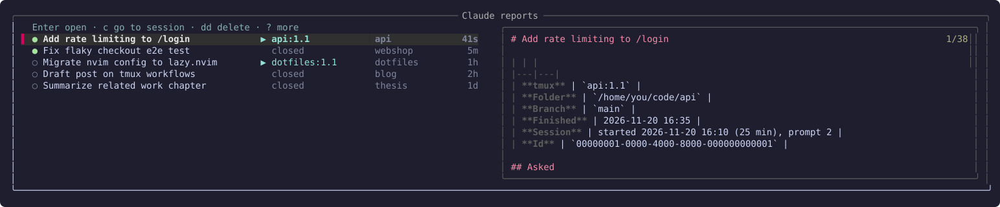
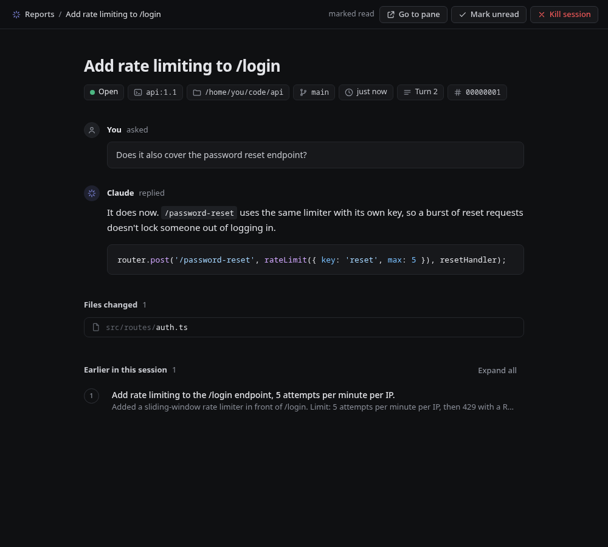

# tmux-claude-reports

A report each time [Claude Code](https://claude.com/claude-code) finishes a reply: what you
asked, Claude's final answer, the files it changed, and where it ran. You can read reports in a
tmux popup or open them in the browser, and jump back to the session with one key.

The point is to stop babysitting panes. Give a session a job, go do something else, and read
the result later in a proper markdown renderer instead of scrolling a terminal. The session
can stay open or not: when you are done with it, `/exit` frees its RAM and the report stays.





*(Screenshots rendered by `scripts/demo.sh` from made-up sessions.)*

- **Written by a `Stop` hook** every time Claude finishes a turn. It costs no tokens and the
  agent can't forget it. There is one report per session, rewritten after each reply. It
  covers your latest prompt and Claude's final reply (the hook's `last_assistant_message`),
  the files changed during that turn, and the earlier turns of the session (your prompt
  and Claude's reply to it, the last 20 turns). On the page those are collapsed, click to
  expand.
- **Unread only if you weren't watching:** a reply that arrives in the pane you are looking at
  counts as read. That means the pane is active, its window is active, and the terminal has
  focus according to tmux focus events. Every other reply bumps the unread count.
- **Title:** your `/rename` name if you set one, else Claude's own session title, else the
  tmux pane title, else your first prompt.
- **Picker** (`fzf`, vim keys) with a rendered preview (`bat`). Unread reports are marked `●`,
  unfinished ones `!`. If Claude still has background tasks running, the report says so.
- **Enter opens the report in the browser** as a page built for reading: the title with the
  session's status, tmux pane, folder, branch and age as small labels, then your prompt and
  Claude's reply as a conversation, the files changed, and the earlier turns as a timeline
  (all of them, one line each, click to expand, or "Expand all"). Long prompts are collapsed to their
  first line, and code blocks get a copy button. It follows the system's light or dark
  theme. Three buttons sit in the top bar:
  - **Go to pane** switches tmux to the session's pane and raises the Konsole window (and tab)
    that shows it. If the session is closed, the button becomes **Resume session**.
  - **Mark read / unread.** Opening a report marks it read; "Mark unread" keeps it as a
    reminder.
  - **Kill session** closes the tmux pane, and with it the Claude process, after you confirm.
    The report stays.

  - **New reply · Reload** appears when Claude has replied again since you loaded the page.
    The page checks when you switch back to the tab and every 5 s while it is visible. It
    doesn't reload by itself, so your scroll position stays put.
  - **Working on your new message** appears while Claude works on a prompt you sent after
    the report was written, with the prompt's text and the time you sent it. **Waiting for
    you in the pane** appears when Claude is stuck on a permission prompt or a question. The
    report itself still shows the last finished turn until the new reply arrives.

  The pages come from a small server on `127.0.0.1` (see [Safety](#safety)). systemd starts it
  on the first request and it exits after 30 idle minutes, so nothing runs while you aren't
  using it, and buttons in an old tab still work. Without the server you get a plain page with
  no buttons.
- **Rendering:** if
  [live-preview.nvim](https://github.com/brianhuster/live-preview.nvim) is installed, its
  markdown-it and highlight.js render the replies (the page uses its own styling on top of
  the plugin's GitHub CSS). Otherwise python-markdown renders a plain page. Raw HTML in a transcript is shown as text, never
  run.
- **`c` goes to the session.** It goes through
  [tmux-claude-sessions](https://github.com/dodokr/tmux-claude-sessions) when installed, which
  jumps to the pane if the session is still open and resumes it in a new tmux window if not.
  Without it, the session is always resumed in a new window.
- **Open sessions are marked in the picker** with `▶` and their current tmux target, using
  the state that [tmux-claude-tasks](https://github.com/dodokr/tmux-claude-tasks) keeps: `◐`
  while Claude is working, `?` while it waits for you. Closed ones show `closed`. The preview
  of a busy session starts with the prompt it is working on.
- **Messages you queue** while Claude is working are part of that turn's prompt, under
  "Sent while Claude was working".
- **Unread count in the tmux status line**, refreshed the moment a report is written.
- **`prefix e` in a Claude pane** opens that session's report in the browser directly, without
  the picker. It needs tmux-claude-tasks, which records which session runs in which pane.
- **One tab per report** with the optional Chrome extension in `chrome-extension/`. Opening a
  report that is already open, in any window, switches to that tab and reloads it, instead
  of opening a duplicate. See [Chrome extension](#chrome-extension).
- **Rewinds are handled.** A rewind keeps the old messages in the transcript and branches off
  an earlier one. Reports follow only the current branch: the newest message's chain of
  parents, across `/compact`. Prompts you rewound away don't show up.
- Reports older than 14 days are pruned.

## Requirements

- Python ≥ 3.11 (standard library; python-markdown is used only as a fallback renderer)
- A recent [fzf](https://github.com/junegunn/fzf) (uses `--gutter`, `--with-shell`)
- tmux ≥ 3.3 for the popup
- Optional: `bat` for the preview, live-preview.nvim for the HTML page (without it you get a
  plain one), and the [Inter](https://rsms.me/inter/) font (`pacman -S inter-font`), which the
  page uses when installed; it falls back to your system's sans-serif
- For the buttons: systemd (user instance) for socket activation, tmux-claude-tasks (to know
  which pane runs which session), and KDE Plasma 6 with Konsole for raising the window (`qdbus6`).
  Without KDE, "Go to pane" still switches tmux; it just can't raise the terminal.

## Install

```sh
ln -s "$PWD/claude-reports" ~/.local/bin/claude-reports
```

Add the hook to `~/.claude/settings.json`, next to any `Stop` hooks you have:

```json
{
  "hooks": {
    "Stop": [
      { "hooks": [{ "type": "command", "command": "~/.local/bin/claude-reports hook" }] }
    ]
  }
}
```

Then in `tmux.conf`:

```tmux
bind C-e display-popup -E -w 90% -h 85% "~/.local/bin/claude-reports"
# From a pane running Claude: open that session's report straight away.
bind e run-shell -b "~/.local/bin/claude-reports open-pane '#{pane_id}'"
set -g focus-events on   # lets a reply you watched count as read
set -ag status-right "#(~/.local/bin/claude-reports count --tmux)"
```

Install the server's socket (systemd starts the server on demand):

```sh
cp systemd/claude-reports.socket systemd/claude-reports.service ~/.config/systemd/user/
systemctl --user daemon-reload
systemctl --user enable --now claude-reports.socket
```

For Chrome to come to the front when a report opens, KWin must let it raise itself. Add a
window rule for the window class `google-chrome` with "Focus stealing prevention: None".

### Chrome extension

Optional. Without it, every open makes a new tab.

1. Open `chrome://extensions` and switch on **Developer mode** (top right).
2. Click **Load unpacked** and pick the `chrome-extension/` folder of this repo.

It only has access to `http://127.0.0.1:47823/*`, so Chrome shows it the URLs of report tabs
and no others. It makes no network requests. If you change the port, change it in
`manifest.json` and `background.js` too.

## Keys

| Key | |
|---|---|
| `j` / `k`, `g` / `G` | move, top / bottom |
| `Enter` | open in the browser (marks it read) |
| `c` | go to the session (jump to its pane, or resume it) |
| `m` | mark read / unread |
| `dd` | delete the report |
| `a` | mark all read |
| `C-d` / `C-u` | scroll the preview |
| `/` | filter (Esc leaves the filter) |
| `t` | switch to tmux-claude-tasks, if installed |
| `?` | show all keys (the header shows only the main ones) |
| `q`, `Esc` | quit |

## Configuration

| Variable | Default | |
|---|---|---|
| `CLAUDE_REPORTS_DIR` | `$XDG_STATE_HOME/claude-reports` | where reports live |
| `CLAUDE_REPORTS_KEEP_DAYS` | `14` | prune age |
| `CLAUDE_REPORTS_BROWSER` | `google-chrome-stable`, else `xdg-open` | browser command |
| `CLAUDE_REPORTS_FOCUS` | — | command run after opening; `{title}` is the page title |
| `CLAUDE_REPORTS_ASSETS` | live-preview.nvim's `static/` (lazy.nvim path) | markdown-it assets |
| `CLAUDE_REPORTS_PORT` | `47823` | server port (keep it in sync with the `.socket` file) |
| `CLAUDE_REPORTS_IDLE` | `1800` | seconds without requests before the server exits |
| `CLAUDE_REPORTS_CONFIG` | `$XDG_CONFIG_HOME/claude-reports` | where avatar pictures are |
| `CLAUDE_REPORTS_RESUME` | `$CLAUDE_SESSIONS_RESUME`, else `claude --resume {id}` | used without claude-sessions |

**Avatars:** put `avatar-you.jpg` and `avatar-claude.jpg` (or `.png`, `.webp`, `.gif`, up to
256 KB; about 96×96 px is plenty) in `~/.config/claude-reports/` to show them next to your
prompts and Claude's replies instead of the icons. They are embedded in the page.

The page title is unique (`<title> · claude-report <id>`), so a `CLAUDE_REPORTS_FOCUS` script can
find the exact browser window showing the report and raise it.

`claude -p` and SDK runs get a report only when they run inside tmux, so scripts that call
Claude in the background don't flood the list.

## Safety

The buttons do real things: switch your terminal, kill processes. The server has to make sure
that only you, clicking in a report page, can trigger them. Here is what could go wrong and
what stops it:

- **Other machines:** the server listens on `127.0.0.1` only. Nothing outside this computer can
  reach it.
- **Other websites you have open.** This is the main risk. Any page in your browser can send
  requests to `127.0.0.1`, for example a hidden form that POSTs to `/api/kill/...`. Four checks
  stop it, and each would be enough on its own:
  1. **A secret token.** It is 64 random hex characters in `~/.local/state/claude-reports/token`
     (mode 600, so only your user can read it), and every action must carry it in an
     `X-Claude-Reports` header. Another site doesn't know it. It also can't send a custom
     header to another origin without a CORS preflight, which this server never approves.
  2. **A cookie** (`HttpOnly; SameSite=Strict`), which the browser never attaches to requests
     started by other sites.
  3. **The `Origin` header** of every action must be the server's own address. Browsers set
     this header, and pages can't fake it.
  4. **The `Host` header** must be `127.0.0.1:47823`. This blocks *DNS rebinding*: an attacker
     makes their own domain resolve to `127.0.0.1`, so the browser thinks their page and this
     server are the same site. The browser still sends the attacker's domain as `Host`, so
     the server refuses.
- **Being framed:** pages send `X-Frame-Options: DENY` and `frame-ancestors 'none'`, so another
  site can't load a report in an invisible frame and trick you into clicking Kill
  (clickjacking).
- **Content of the report itself.** A transcript can contain anything, including text written
  to look like HTML or scripts (prompt injection, pasted web pages). markdown-it runs with
  `html: false`, so such text is shown and never executed. The Content-Security-Policy also
  only allows the page's own scripts (a per-request nonce), loads nothing from other
  servers (no tracking images), and allows network requests only back to this server.
- **Other users on this machine** can connect to `127.0.0.1` too. Without the token or the
  cookie, the server only answers `/ping` and the public markdown/CSS assets. Reports and
  actions are refused, and the reports folder is mode 700.
- **A stale report killing the wrong thing.** Kill only acts if tmux-claude-tasks says that
  pane is running *this* session id right now, in the same process (checked by pid and start
  time). If you have started anything else in that pane since, it refuses.
- **Where the token travels:** `open` gives Chrome the URL `/r/<id>?t=<token>` once. The server
  swaps the token for the cookie and redirects to `/r/<id>`, so the token disappears from the
  address bar. It can still show up in Chrome's local history. Anyone who can read your Chrome
  history can already read the token file, so this adds no new access. If it ever leaks,
  delete the token file and a new one is made.
- Assets are served only from the live-preview.nvim folder and only as
  `.js`/`.css`/fonts/`.svg`. Paths that try to climb out (`../`) are refused.

## Demo

`scripts/demo.sh` opens the picker on an isolated tmux server with made-up reports. The real
hook writes them from synthetic transcripts, so it shows what you'd get without touching your
own state. `--capture` prints the picker as text (pipe it through `scripts/ansi2svg.py` for an
SVG), and `--page OUT.png` screenshots a report page in headless Chrome.

## Tests

```sh
python3 -m unittest discover tests
```
